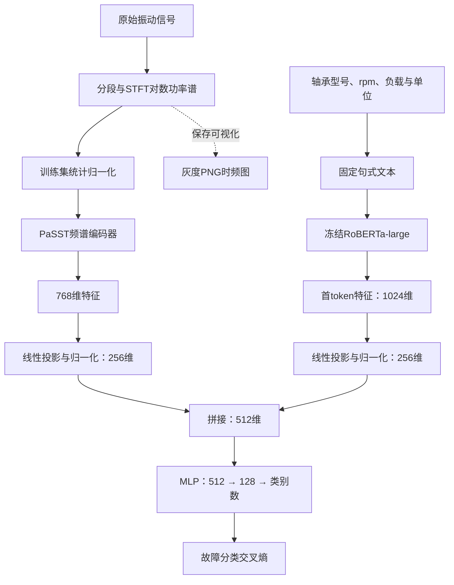

# 时频图与设备工况文本融合故障诊断基线

实现方向：**振动信号 → STFT 时频表示；轴承型号、转速、负载 → 文本；两路特征拼接 → 故障分类。**

主配置保留 DCASE 2025 Task 6 的 PaSST / RoBERTa 双编码器骨干，但将音频检索改成故障分类。
这是独立编写的任务改编基线，不是原论文结果的复现，不直接加载 DCASE 的完整检索检查点。
原始出处及逐项改动见 [docs/UPSTREAM.md](docs/UPSTREAM.md)。

## 架构



**图像在哪里生成？** `prepare` 在 STFT 后得到二维对数功率谱，保存为 `.npy`，
随后映射灰度并保存为真实 `.png`。PNG 没有坐标轴、标题和类别文字，低频在图像底部。

两种输入路线：

| 配置 | 信号输入 | 信号编码器 | 文本编码器 |
|---|---|---|---|
| `configs/passt_text.json` | `.npy` 数值时频矩阵 | PaSST，与原基线相同型号 | RoBERTa-large |
| `configs/resnet18_text.json` | 真实 `.png` 时频图 | ImageNet ResNet18，图像版替换骨干 | RoBERTa-base |

主配置最接近前面推荐的 PaSST 双编码器；PNG 配置更适合明确研究“图片＋文本”，
同时降低模型规模。两者是不同实验配置，不能混称为同一个原始模型。
PaSST 的 AudioSet 预训练频率语义来自 Mel 频谱，本项目改成线性频率 STFT，迁移效果需真实数据验证。
模型不会将 PNG 直接送入 PaSST 的音频波形接口。

## 安装

建议 Python 3.10 或 3.11。GPU 用户先从 [PyTorch 官方安装页](https://pytorch.org/get-started/locally/)
安装配套的 PyTorch 2.5.1、torchvision 0.20.1、torchaudio 2.5.1。
本项目约束 torch 2.4–2.5 系列，以兼容原 PaSST 软件栈；不要混装 CPU 与 CUDA 轮子。

```bash
git clone https://github.com/L-byte123/multi_model_baseline.git
cd multi_model_baseline
python -m venv .venv
```

Windows PowerShell 激活：

```powershell
.\.venv\Scripts\Activate.ps1
```

Linux / macOS 激活：

```bash
source .venv/bin/activate
```

安装所有研究配置及测试依赖：

```bash
python -m pip install -e ".[text,image,passt,test]"
```

只使用 PNG 图像版本：

```bash
python -m pip install -e ".[text,image,test]"
```

首次训练需要下载信号骨干和 Hugging Face 文本模型权重。已有本地文本模型时将
`text_model` 改成模型目录，并设置 `local_files_only: true`。不会自动降级成随机模型。
冻结文本骨干可节省梯度内存，但 RoBERTa-large 本身仍是大模型；显存不足时使用
RoBERTa-base、降低 batch_size，或开启 `freeze_signal`。

## 数据格式

先制作一个“每行一个原始记录”的 CSV；路径相对这个 CSV 所在目录。
[examples/recordings.csv](examples/recordings.csv) 仅展示字段格式，不包含真实数据。

```csv
signal_path,sample_rate,label,group_id,split,bearing_model,rpm,load,load_unit
normal_train.npy,12000,normal,recording_01,train,6205,1797,1,hp
inner_train.npy,12000,inner,recording_02,train,6205,1797,1,hp
normal_val.npy,12000,normal,recording_03,val,6205,1772,2,hp
inner_val.npy,12000,inner,recording_04,val,6205,1772,2,hp
normal_test.npy,12000,normal,recording_05,test,6205,1750,3,hp
inner_test.npy,12000,inner,recording_06,test,6205,1750,3,hp
```

- 原始信号支持一维 `.npy`、无表头的数值 `.csv` 和 `.mat`。
- MAT 文件必须增加 `signal_key` 列指定变量；多通道 `[时间,通道]` 数据增加 `channel` 列指定列索引。
- `label` 可以是任意非空类别字符串；类别映射只由训练集建立。
- `group_id` 表示不能跨集合的原始记录/实验组。一个 group 的所有记录必须在同一个 split。
- 先划分原始记录，再切窗。同一次采集的相邻窗口不能随机分配到训练与测试集合。
- 所有记录先统一采样率。否则同一频率像素没有共同物理意义。
- 将负载统一到明确单位，如 hp、N 或 N·m。数值对照强制所有集合使用相同单位。
- 文本由设备字段白名单生成，不读取 `label`、故障文件名或样本路径。

文本示例：`Bearing model: 6205. Shaft speed: 1797 rpm. Load: 1 hp.`
默认使用英文模板匹配 RoBERTa；数值的小数点和单位不会被删掉。

## 从原始信号生成时频图

```bash
python -m mm_baseline prepare --recordings data/raw/recordings.csv --output data/prepared --window 2048 --step 2048 --n-fft 256 --hop 64
```

内部依次执行：切窗 → 去均值 → Hann 窗 STFT → `10*log10(|STFT|²+eps)` → 保存矩阵 → 保存 PNG。
默认保留 0 到 Nyquist 频率；可用 `--fmin` 和 `--fmax` 指定 Hz 范围。
尾部不足一个完整窗口的数据舍弃，不会为训练/测试采用不同规则。

输出：

```text
data/prepared/
  manifest.csv         # 每行一个窗口，保留所属 split/group
  preprocessing.json   # STFT 设置与仅由训练集计算的归一化统计
  spectrograms/*.npy   # 原始二维对数功率谱，低频在第0行
  images/*.png         # 灰度图，低频在底部，加载时翻回矩阵顺序
```

PNG 采用训练集均值 ±3 标准差作为统一灰度范围，不按每张图独立拉伸。
NPY 路线保留完整标准化范围；PNG 路线有灰度量化与截断，不能假设两种输入完全等价。
ResNet 输入使用三通道灰度复制和 ImageNet 归一化，不做时间/频率随机翻转。

## 训练

PaSST 主配置：

```bash
python -m mm_baseline train --manifest data/prepared/manifest.csv --config configs/passt_text.json --output runs/passt_text
```

PNG 图像配置：

```bash
python -m mm_baseline train --manifest data/prepared/manifest.csv --config configs/resnet18_text.json --output runs/resnet_text
```

CPU 可加 `--device cpu`；GPU 可加 `--device cuda`。默认 `auto`。
训练头与骨干使用不同学习率，文本默认冻结；冻结骨干保持 eval 状态，不更新 BatchNorm。
验证集 macro-F1 选择最佳 epoch，最后只用该 checkpoint 评估一次测试集。
统计以窗口为单位，不是以独立原始记录为单位；不要将大量相邻窗口当作独立实验重复。

每次实验使用新的输出目录：

```text
runs/resnet_text/
  best.pt                 # 模型、类别映射、配置、训练归一化和文本模型结构
  tokenizer/              # 随检查点携带，预测不再下载tokenizer
  run.json                # 参数设置、集合样本数、运行环境
  preprocessing.json      # 新信号生成时频图时复用的训练设置与统计
  history.json            # 训练损失与验证指标
  test_metrics.json       # Accuracy、macro-F1、各类指标、混淆矩阵
  test_predictions.csv    # 每个样本的预测及各类概率
```

模型检查点由本项目训练产生，不是预先训练好的轴承分类模型。

## 预测

```bash
python -m mm_baseline predict --checkpoint runs/resnet_text/best.pt --manifest data/prepared/manifest.csv --split test --output runs/predictions.csv
```

预测 CSV 可以没有 `label`；仍需 `sample_id`、输入路径及设备参数字段。
`--split all` 可以预测没有 split 列的纯推理 CSV。
检查点保存完整模型结构与权重，恢复不下载信号预训练权重或文本模型；tokenizer 从同目录读取。
将 `best.pt` 和 `tokenizer/` 一起搬到别的机器即可恢复。
输入的 STFT 频率范围、采样率、窗口参数必须与训练时一致；本项目生成的目录会自动检查这些设置。
若自行制作 PNG，应使用训练时的灰度映射及低频在底部约定，而不是任意绘图软件的伪彩图。

新的原始信号可只提供 `split=test` 的记录，预处理时指定训练统计：

```bash
python -m mm_baseline prepare --recordings data/new_raw/recordings.csv --output data/new_prepared --reference-preprocessing runs/resnet_text/preprocessing.json
python -m mm_baseline predict --checkpoint runs/resnet_text/best.pt --manifest data/new_prepared/manifest.csv --output runs/new_predictions.csv
```

此时原始记录CSV中的 `label` 可填 `unknown` 占位，预测不读取该字段。
`prepare` 的 STFT 参数必须与训练完全一致；若训练使用自定义窗口或频率范围，在此同样传入。

## 对照实验

同一份划分下运行以下配置，用于识别文本带来的贡献：

| 配置文件 | 输入 |
|---|---|
| `resnet18_image.json` | 仅时频图 |
| `resnet18_numeric.json` | 时频图＋标准化rpm/负载＋型号one-hot |
| `resnet18_text.json` | 时频图＋RoBERTa工况文本 |
| `text_only.json` | 仅工况文本，检查工况是否与类别意外绑定 |

每个模型都使用交叉熵，不把“相同工况”当作“相同故障”的对比正样本。
数值对照的统计和型号词表只从训练集拟合；未知型号使用单独的 unknown 位。
比较时保持图像骨干、投影维度、划分与训练预算一致，并更换多个 seed 报告波动。

## 修改入口

| 文件 | 可替换内容 |
|---|---|
| `mm_baseline/preprocess.py` | STFT 参数、原始格式读取、时频图生成 |
| `mm_baseline/metadata.py` | 设备参数文本模板、数值对照编码 |
| `mm_baseline/model.py` | 两个编码器、投影、拼接、分类头 |
| `mm_baseline/data.py` | NPY/PNG 加载、输入尺寸、数据检查 |
| `mm_baseline/engine.py` | 优化器、验证、checkpoint 和预测 |
| `configs/*.json` | 模型选择、冻结策略、维度、学习率、批量大小 |

融合创新只需修改 `FaultClassifier.forward()` 中 `torch.cat(features, dim=-1)` 附近及分类头。
如增加其他设备字段，同步修改 metadata 模板、CSV 验证和数值对照。

## 验证与离线演示

```bash
python -m pytest -q
python -m mm_baseline.smoke --output runs/smoke
```

`smoke` 在本地建立随机初始化的小 RoBERTa 与微型CNN，生成合成信号，跑两轮训练、
保存和恢复检查点并输出预测；无需联网。它验证接口，不代表预训练模型语义能力或真实故障精度。
研究实验用 PaSST/ResNet18 配置，不用 `tiny` 信号骨干。
测试覆盖 STFT 频率、PNG 映射、数据泄漏拒绝、冻结梯度、模型前后向与预测恢复一致性。

也可先生成合成原始信号练习预处理：

```bash
python -m mm_baseline demo --output data/demo_raw
python -m mm_baseline prepare --recordings data/demo_raw/recordings.csv --output data/demo_prepared
```

本仓库没有上传用户数据、个人缓存或训练权重。实测范围见 [docs/VALIDATION.md](docs/VALIDATION.md)。
